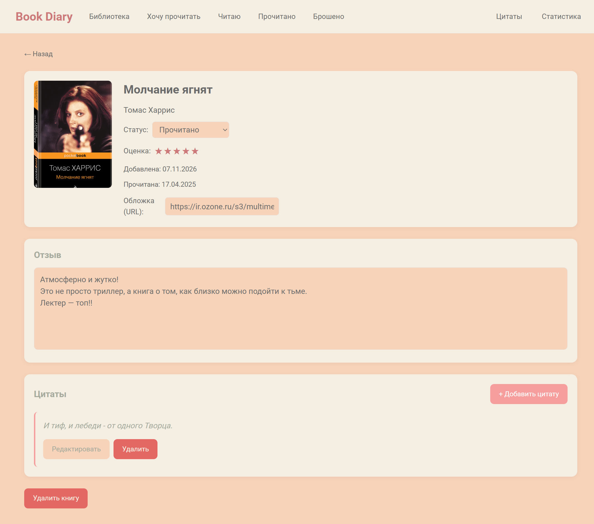
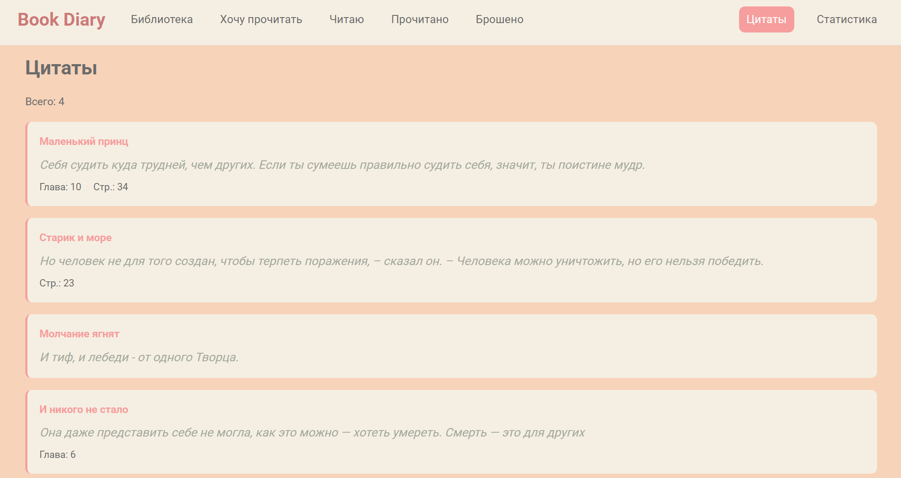
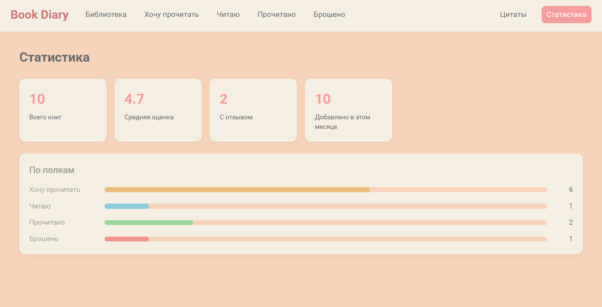

# Book Diary
Book Diary — это SPA для ведения личной библиотеки. Пользователь добавляет книги, отмечает статус чтения (хочу прочитать / читаю / прочитано / брошено), ставит оценки, пишет отзывы, сохраняет цитаты и смотрит статистику.

📕📗 [Открыть Book Diary](https://kapitonova13.github.io/book-diary/) 📘📙






## Особенности

- **Работа без бэкенда**: приложение полностью работает в браузере, серверная часть не используется.
- **Сохранение данных**: все данные (книги, отзывы, цитаты) сохраняются в `localStorage` и остаются доступными после перезагрузки страницы. Данные хранятся локально в браузере пользователя.


## Возможности

- **Библиотека**: добавление книг (название, автор, статус, дата окочания (появляется только при статусе «Прочитано»), оценка, отзыв), редактирование и добавление обложки по URL на странице книги, удаление с подтверждением.
- **Поиск и фильтры**: поиск по названию/автору с debounce (300 мс), фильтр по статусу (хочу/читаю/прочитано/брошено), сортировка (новые, старые, по оценке, по названию).
- **Полки**: быстрый доступ к книгам по статусу (`/shelf/:status`).
- **Цитаты**: добавление цитат на страницн книги, редактирование, удаление. Отдельная страница `/quotes` со всеми цитатами из всех книг.
- **Статистика**: всего книг, средняя оценка, с отзывом, добавлено за месяц, визуализация по полкам.

## Технологии

- **React 19** — хуки (`useState`, `useEffect`, `useReducer`, `useMemo`, `useCallback`, `useContext`), Context API для глобального состояния
- **React Router 7** — маршрутизация `BrowserRouter`, `Routes`, `NavLink`, `useParams`, `useNavigate`
- **Кастомные хуки** — `useLocalStorage` (синхронизация с localStorage), `useDebounce` (оптимизация поиска и обработки ввода)
- **React-приёмы** — `React.memo` (оптимизация рендеринга), `createPortal` (модальные окна)
- **Web API** — `crypto.randomUUID()` (генерация уникальных ID), `localStorage` (хранение данных)
- **SCSS** — БЭМ, CSS-переменные
- **Vite** — сборка, path alias `@`

## Структура проекта

```bash
src/
├── main.jsx                    # Точка входа: подключение роутера и BooksProvider
├── App.jsx                     # Настройка маршрутов приложения
├── context/
│   └── BooksContext.jsx        # Глобальное состояние книг и управление действиями через useReducer
├── hooks/
│   ├── useLocalStorage.js      # Сохранение и синхронизация данных с localStorage
│   └── useDebounce.js          # Отложенное обновление значения
├── data/
│   └── shelves.js              # Конфигурация статусов чтения и вспомогательные функции
├── utils/
│   └── validators.js           # Функции валидации данных книги
├── components/
│   ├── Layout/                 # Общий макет приложения: шапка и Outlet
│   ├── BookCard/               # Карточка книги
│   ├── BookGrid/               # Сетка карточек книг
│   ├── Filters/                # Поиск, фильтрация и сортировка книг
│   ├── Modal/                  # Универсальный компонент модального окна
│   ├── AddBookModal/           # Модальное окно с формой добавления книги
│   ├── AddQuoteModal/          # Модальное окно с формой добавления цитаты
│   ├── QuoteCard/              # Компонент отображения цитаты
│   └── StarRating/             # Компонент оценки книги
├── pages/
│   ├── LibraryPage/            # Главная страница: библиотека, поиск и фильтры
│   ├── BookPage/               # Страница книги с возможностью редактирования
│   ├── ShelfPage/              # Страница книг с определённым статусом чтения
│   ├── QuotesPage/             # Страница со всеми сохранёнными цитатами
│   ├── StatsPage/              # Страница статистики чтения
│   └── NotFoundPage/           # Страница 404
└── styles/
    ├── variables.scss          # Глобальные SCSS-переменные
    └── global.scss             # Глобальные стили и сброс стилей браузера
```
Модель данных
```bash
Book  { id, title, author, coverUrl, status, rating, review, quotes[], createdAt, updatedAt, finishedAt }
Quote { id, text, chapter, page, createdAt }
```

## Установка и запуск
```bash
git clone https://github.com/Kapitonova13/book-diary.git
cd book-diary

# Установить зависимости
npm install

# Запустить dev-сервер
npm run dev
```


